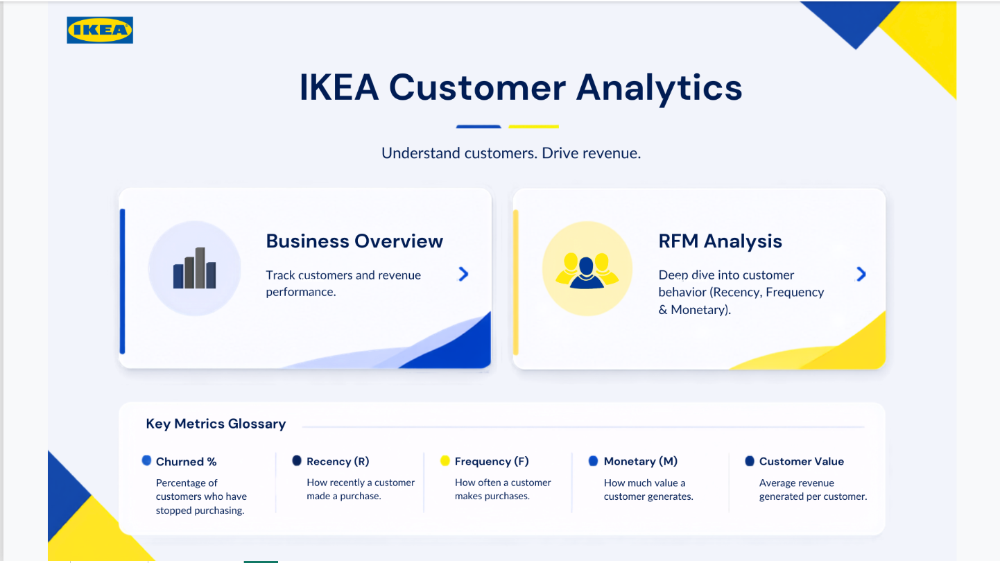
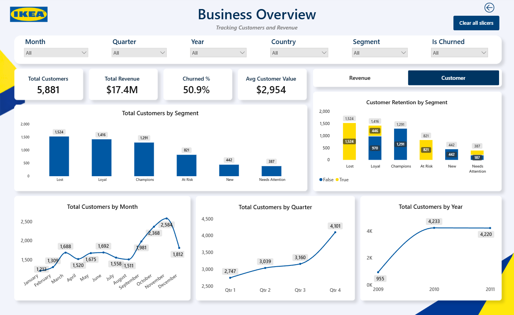
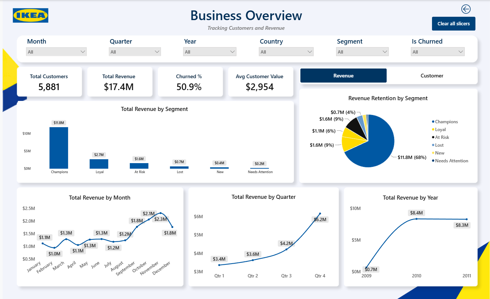
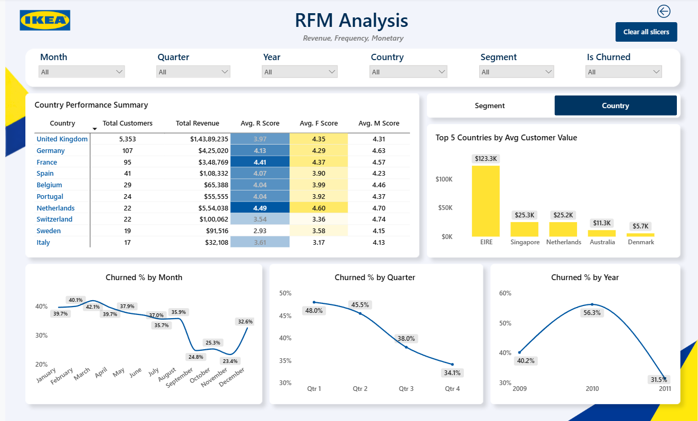
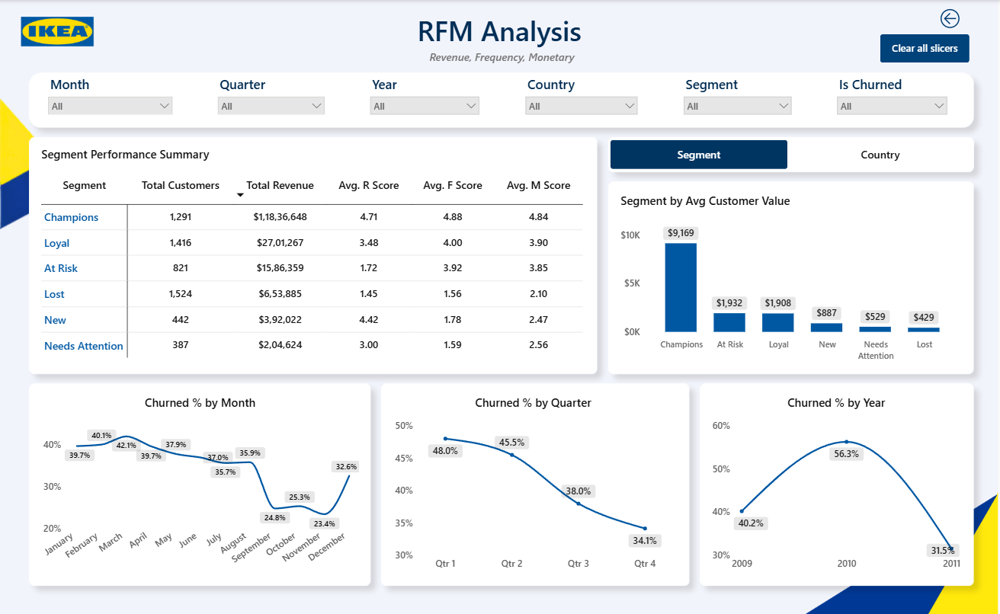

# Customer Analytics & RFM Segmentation – IKEA Gifting

*An end-to-end customer analytics project: SQL data cleaning, RFM segmentation in Python,and an interactive Power BI dashboard to identify high-value customers and churn risk.*

---

## Disclaimer
IKEA Gifting is a fictional company name created for this educational portfolio project. It is not affiliated with, endorsed by, or representative of the real IKEA corporation in any way. All financial figures, customer counts, and business metrics shown in this project are derived entirely from a public, anonymized transactional dataset and do not reflect any real company's actual performance. The IKEA visual branding used in the dashboard is for design and storytelling purposes only.

---

## Project Overview

This project simulates a real world analytics engagement for a fictional UK based gifting and home decor ecommerce brand, IKEA Gifting. The goal was to take raw, messy transactional data all the way through to a decision ready business intelligence dashboard, using the same workflow a data analyst would follow inside a real company: define the business problem first, clean and validate the data in SQL, build the analytical logic in Python, and deliver the insight through an interactive Power BI report.

---

## My Thinking Process
Most portfolio projects start with a dataset and work backward to a question. I reversed that. I started by writing a Business Requirements Document before touching any data, forcing myself to define exactly what business decision this analysis needed to support. Every technical step after that traces back to one of the questions in that document.

I also deliberately chose a dataset that's less commonly used in existing tutorials (Online Retail II instead of the more saturated Olist dataset), and chose to genuinely clean the data rather than use a pre cleaned version, so this project includes real data quality problems: mixed date formats, invalid row types, duplicate transactions, and missing customer identifiers. Solving these is a large part of what this project actually demonstrates.

---

## Business Problem
The business wants to identify its most valuable customers and reduce churn among customers who are at risk of leaving. Leadership currently has no structured view of customer value, so retention efforts are reactive instead of targeted.

**Objective:** Identify the most valuable customer segments and quantify churn risk so Marketing and CRM teams can prioritise effort and spend.

---

## Business Questions Answered

- Who are our most valuable customers and how much revenue do they contribute?
- Which customers have gone quiet and are at risk of churning?
- How do customer value and retention trend over time, by month, quarter, and year?
- How do customer value and churn risk differ by country?
- What action should the business take for each customer segment?

The full requirements are in the [Business Requirements Document](docs/IKEA_Gifting_BRD.docx).

---

## Key Findings
- *Champions* represent roughly 22% of the customer base but generate close to 68% of total revenue, a strong revenue concentration.
- Overall churn sits at **50.86%** (90 day inactivity threshold), indicating retention is a significant, not marginal, business risk.
- Average customer value varies sharply by segment, from a few hundred for *Lost* customers to several thousand for *Champions*.
- Revenue shows clear seasonal spikes in **Q4**, which starts rising from **September**. This is consistent with a gifting focused product category.
- The *UK* accounts for 5,353 customers (91%) and about $14.4M (83%) of revenue.

---

## Recommendations

| Segment | Suggested action |
|---|---|
| Champions | Protect first. Offer loyalty perks and early access, since they produce about 68% of revenue |
| Loyal | Push toward Champions with cross-sell offers. 446 are already inactive, so add a reactivation reminder |
| At Risk | Run a win-back campaign. All 821 are past the 90-day threshold and were previously frequent buyers |
| New | Offer an incentive for a second purchase to turn first-time buyers into repeat customers |
| Needs Attention | Send seasonal gift reminders to raise purchase frequency |
| Lost | Use low-cost reactivation only, such as email. Average value is $429, so heavy spend is hard to justify |

---

## Dashboard Structure
**Page 1 - Home:** Project title, navigation to the two report pages, and a glossary defining Recency, Frequency, Monetary, and Churned %.

**Page 2 - Business Overview:** total customers, total revenue, churn %, and average customer value as headline KPIs, with a revenue/customer toggle, segment breakdowns, and month/quarter/year trend views. Filterable by month, quarter, year, country, segment, and churn status.

**Page 3 - RFM Analysis:** A toggle switches between a segment view (performance summary, average customer
value by segment) and a country view (country summary, top 5 countries by average
customer value). Churned % by month, quarter and year appears in both.

---

## Data Source
**Source:** [Online Retail II, UCI Machine Learning Repository](https://archive.ics.uci.edu/dataset/502/online+retail+ii), donated by Daqing Chen. A real, anonymized transactional dataset from a UK based, non store online retailer selling all occasion gift ware, covering December 2009 to December 2011. 1,067,371 raw transaction rows across two sheets. Licensed under Creative Commons Attribution 4.0 International.

---

## Tools and Tech Stack

| Tool | Purpose in this project |
|---|---|
| SQL Server / SSMS | Data import, cleaning, deduplication, and exploratory querying on the full 1M+ row dataset |
| Python (pandas) | RFM calculation, customer scoring, segmentation logic, and churn flagging |
| Jupyter Notebook |  Notebook	Interactive development environment for the Python analysis |
| Power BI Desktop | Three page interactive dashboard: executive summary and RFM deep dive |
| DAX | Measures for customer counts, revenue totals, and average customer value |

## Core Concepts Demonstrated

- **RFM Analysis** — scoring customers on Recency, Frequency, and Monetary value to quantify customer worth on a comparable scale
- **Customer Segmentation** — translating raw RFM scores into business meaningful groups (Champions, Loyal, At Risk, New, Needs Attention, Lost)
- **Churn Definition and Flagging** — applying a fixed inactivity threshold to identify customers at risk of lapsing
- **Data Quality Handling** — resolving mixed date formats, invalid type conversions, and duplicate detection using SQL window functions
- **Dimensional Modeling for BI** — structuring a single unified table so multiple report pages can share one clean source without manual relationships
- **Interactive BI Design** — slicers, bookmark based toggles, and a multi page navigation structure inside Power BI

## Project Workflow

### Step 1 — Business Requirements Document (`docs/`)
Defined scope, business questions, key definitions, and success criteria before any data work began.

### Step 2 – Data Cleaning and Exploration (SQL, `sql/`)

1. Combined the two yearly tables and converted dates and prices to proper data types. This resolved a mixed date format issue that affected over half the dataset.
2. Checked for missing customer IDs, zero or negative quantities, missing descriptions and exact duplicates.
3. Removed 34,335 exact duplicate rows using a window function (1,067,371 rows down to 1,033,036), and validated row counts at every step against the published UCI total.

### Step 3 – RFM Segmentation & churn analysis(Python, `notebooks/`)

1. Excluded rows with a missing `Customer_ID` or `quantity` of zero or below (returns and cancellations).
2. Calculated, for each of the 5,881 remaining customers:
   - **Recency:** days since the last purchase, measured from a snapshot date of 2011-12-10
   - **Frequency:** number of distinct invoices
   - **Monetary:** total of quantity multiplied by price
3. Scored each metric from 1 to 5 using quintiles, where 5 is best.
4. Assigned each customer to one of six segments using the rules below.
5. Flagged a customer as churned if the last purchase was more than 90 days before the snapshot date.

| Segment | Rule |
|---|---|
| Champions | R ≥ 4, F ≥ 4, M ≥ 4 |
| Loyal | R ≥ 3, F ≥ 3 |
| At Risk | R ≤ 2, F ≥ 3 |
| New | R ≥ 4, F ≤ 2 |
| Needs Attention | R = 3, F ≤ 2 |
| Lost | All others |

### Step 4 – Power BI, Dashboard Build (`dashboard/`)
Merged the segmentation results back onto transaction level data to create a single analysis ready table, then built a three page report.

---

## How to Reproduce
1. Download the Online Retail II dataset from the UCI Machine Learning Repository
2. Run `sql/01` to `03` in order and export `RetailCleaned` table.
3. Run `notebooks/04_rfm_segmentation.ipynb` to generate the segmented dataset.
4. Open `dashboard/IKEA_RFM_Dashboard.pbix` in Power BI Desktop.

## Author

Aditi Shaktawat | [LinkedIn](https://www.linkedin.com/in/aditi-shaktawat/)

*Independent portfolio project using a public dataset. Not affiliated with IKEA.*

